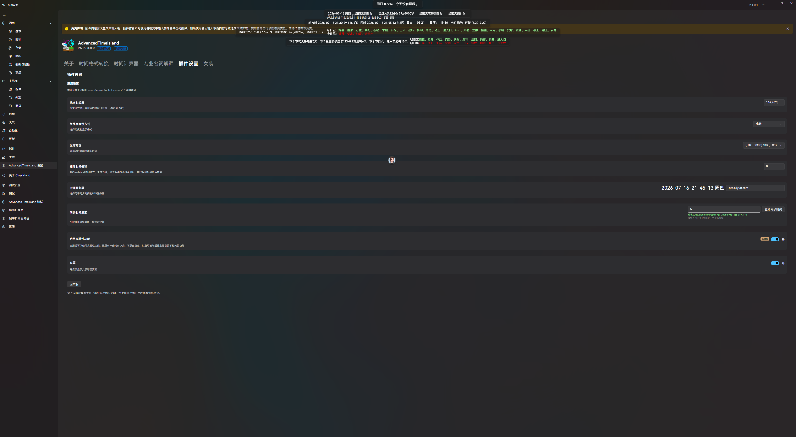

# AdvancedTimeIsland

在ClassIsland自动化添加支持高级触发时间的插件



图片仅供参考  
AdvancedTimeIsland [](https://github.com/inf2147483647/AdvancedTimeIsland/releases/latest)  
AdvancedTimeIslandHanfu [](https://github.com/inf2147483647/AdvancedTimeIslandHanfu/releases/latest)

> \[!caution]
>
> # 免责声明
>
> 插件内包含大量文本输入框，插件作者不对使用者在其中输入的内容做任何担保，如果使用者因输入不当内容导致造成不良影响，使用者需自行承担相关责任，插件作者概不负责。

> \[!caution]
> 本项目的代码将由AI生成，本项目能够保证的是功能正常 ~~（图标是人类做的，部分文案是AI生成的，介绍也是）（这句话也是人类写的）~~

# 协助开发

<details>
<summary>PR(pull request)教程：</summary>

### 提交流程概览 / Submission Workflow Overview

Fork 仓库 → 添加你的文件 → 提交 Commit → 发起 Pull Request → 等待审核合并
Fork repo → Add your files → Commit → Open Pull Request → Wait for review & merge

---

### 第一步：Fork 仓库 / Step 1: Fork the Repository

> **Fork** = 把别人的仓库复制一份到你自己的 GitHub 账号下，让你可以自由修改，不会影响原项目。
> **Fork** = Creating your own copy of someone else's repository under your GitHub account, so you can freely make changes without affecting the original.

1. 打开目标开源仓库页面
2. 点击页面右上角的 **Fork** 按钮
3. 这会在你的 GitHub 账号下创建一份仓库副本

---

1. Go to the target open-source repository page
2. Click the **Fork** button at the top right
3. This creates a copy of the repository under your GitHub account

---

### 第二步：添加你的文件 / Step 2: Add Your Files

> **Commit** = 给你的修改拍一张快照，记录你改了什么内容，每次 Commit 都会生成一条历史记录。
> **Commit** = Taking a "snapshot" of your changes, recording what you modified. Each commit creates a point in the project history.

#### 方法 A：直接在 GitHub 网页上传（最简单）/ Method A: Upload via GitHub Web (Easiest)

1. 进入你 Fork 后的仓库页面（`https://github.com/<你的用户名>/<仓库名>`）
2. 导航到你需要添加文件的对应目录
3. 点击 **Add file** → **Create new file**，填写带路径的文件名即可自动创建对应目录与文件
4. 在编辑区填写文件内容
5. 点击 **Commit changes** 完成提交
6. 若需上传本地文件，再次点击 **Add file** → **Upload files**，选择本地文件并上传至目标目录
7. 点击 **Commit changes** 完成提交

---

1. Go to your forked repository (`https://github.com/<your-username>/<repository-name>`)
2. Navigate to the directory where you want to add files
3. Click **Add file** → **Create new file**. Enter a filename with path to automatically create the corresponding directory and file
4. Fill in the file content in the editor
5. Click **Commit changes** to finish the submission
6. To upload local files, click **Add file** → **Upload files** again, select local files and upload them to the target directory
7. Click **Commit changes** to finish the submission

---

#### 方法 B：使用 Git 命令行 / Method B: Using Git CLI

> **Clone** = 把远程仓库下载到本地电脑。
> **Push** = 把本地的 Commit 上传同步到远程仓库（你的 Fork）。
> **Clone** = Downloading the remote repository to your local machine.
> **Push** = Uploading your local commits back to the remote repository (your Fork).

```bash
# 1. 克隆你 Fork 的仓库 / Clone your forked repository
# 若仓库 commit 历史较多，完整克隆速度较慢，推荐使用 --depth 1 仅拉取最近一次提交，提升下载速度
# The repo has a large commit history, so a full clone may be slow.
# Consider using --depth 1 to only fetch the latest commit for a faster download
git clone --depth 1 https://github.com/<你的用户名>/<仓库名>.git
cd <仓库名>

# 2. 创建目标目录并添加你的文件 / Create target directories and add your files
mkdir -p <目标目录路径>
cp /path/to/your/files/* <目标目录路径>/

# 3. 提交更改 / Commit your changes
git add .
git commit -m "描述本次提交的内容"

# 4. 推送到你的 Fork 仓库 / Push to your forked repository
git push origin main
```

---

### 第三步：发起 Pull Request / Step 3: Open a Pull Request

> **Pull Request（PR）** = 向原仓库的维护者提出申请：我在我的 Fork 里做了一些修改，请把它们合并到原项目里。
> **Pull Request (PR)** = A request to the original repository's maintainers saying: "I've made some changes in my Fork — please merge them into the original project!"

1. 回到你 Fork 的仓库页面
2. 你会看到提示 **"This branch is X commits ahead"**，点击 **Contribute** → **Open pull request**
3. 填写 PR 模板中的描述和检查清单
4. 点击 **Create pull request**

---

1. Go back to your forked repository page
2. You should see a prompt saying **"This branch is X commits ahead"** — click **Contribute** → **Open pull request**
3. Fill in the description and checklist in the PR template
4. Click **Create pull request**

---

### 第四步：等待审核 / Step 4: Wait for Review

提交 PR 后，项目的维护者会对你的提交进行审核，常见校验项包括文件规范、格式要求、内容合规性等。

提交内容需遵守文化尊重原则，**若改动内容涉及汉服及相关中华传统文化元素，严禁出现恶意抹黑、歪曲丑化、侮辱诋毁的表述、图像或其他素材，违规提交将直接驳回，不予合并。**

如果校验未通过，系统或维护者会在评论区留下修改说明。你按照提示完成修改后重新推送，PR 会自动更新。

维护者审核通过后，你的 PR 就会被合并。恭喜你完成了一次对此项目的开源贡献！~~（轰，嚓嚓嚓，推推）~~

</details>

# 插件间接口（对外 API）

AdvancedTimeIsland 向其它 ClassIsland 插件公开**法定节假日查询接口**，供计价时段、考勤统计等场景复用。

> 为什么用反射调用：ClassIsland 为每个插件创建独立的 `AssemblyLoadContext`，直接引用 `AdvancedTimeIsland.dll` 会造成类型标识不一致（同一类型在两个上下文中被视为不同类型）。因此本接口以「类型名 + 静态方法」作为稳定契约，调用方无需在编译期引用本插件。

## 一、声明依赖

在调用方插件的 `manifest.yml` 中声明必需依赖，宿主会保证 AdvancedTimeIsland 已安装并优先加载：

```yaml
dependencies:
  - id: AdvancedTimeIsland
    isRequired: true
```

## 二、接口契约

类型：`AdvancedTimeIsland.Shared.HolidayApi`（命名空间 `AdvancedTimeIsland.Shared`）

| 成员 | 返回值 | 说明 |
| --- | --- | --- |
| `const int Version` | `1` | 契约版本，用于判断能力 |
| `IsStatutoryHoliday(DateTime date)` | `bool` | 是否为法定节假日（放假日）；调休补班日不算 |
| `TryGetHolidayName(DateTime date, out string name)` | `bool` | 取节日名称（如"春节"）；非节假日返回 `false` |
| `GetHolidayDates(int year)` | `DateTime[]` | 指定年份全部法定节假日，按日期升序、已去重 |

## 三、调用示例

### 1. 查询某天是否为法定节假日

```csharp
using System;
using System.Linq;
using System.Reflection;

private const string HolidayApiTypeName = "AdvancedTimeIsland.Shared.HolidayApi";

/// <summary>查询指定日期是否为法定节假日；接口不可用时返回 false。</summary>
public static bool IsStatutoryHoliday(DateTime date)
{
    // 按完整类型名在当前进程已加载的程序集中查找，避免 ALC 类型冲突
    var apiType = AppDomain.CurrentDomain.GetAssemblies()
        .Select(assembly =>
        {
            try { return assembly.GetType(HolidayApiTypeName); }
            catch { return null; }
        })
        .FirstOrDefault(type => type is not null);

    var method = apiType?
        .GetMethods(BindingFlags.Public | BindingFlags.Static)
        .FirstOrDefault(m => m.Name == "IsStatutoryHoliday"
                             && m.GetParameters().Length == 1
                             && m.GetParameters()[0].ParameterType == typeof(DateTime));

    try
    {
        return method?.Invoke(null, new object[] { date }) is true;
    }
    catch
    {
        return false;
    }
}
```

### 2. 按年份批量获取节假日（适合缓存）

```csharp
var method = apiType?.GetMethod("GetHolidayDates", new[] { typeof(int) });
if (method?.Invoke(null, new object[] { 2026 }) is DateTime[] holidays)
{
    // holidays 已按日期升序去重，可直接构建 HashSet 做 O(1) 判断
    var holidaySet = holidays.ToHashSet();
}
```

### 3. 获取节日名称

```csharp
var method = apiType?.GetMethod("TryGetHolidayName");
var args = new object?[] { new DateTime(2026, 2, 17), null };
if (method?.Invoke(null, args) is true)
{
    var name = args[1] as string;   // 例如"春节"
}
```

## 四、行为约定

- **只读**：接口不会修改 AdvancedTimeIsland 的节假日数据。
- **不抛异常**：数据尚未加载、集合正在被编辑等情况下，返回 `false` 或空数组，调用方无需包裹异常处理。
- **数据来源**：与「在校时间统计」使用同一份节假日表，包含联网更新与手动编辑的结果。
- **范围**：仅包含法定节假日（放假日），不包含调休补班日；周末判断请由调用方自行处理。
- **加载时序**：若在 AdvancedTimeIsland 完成加载前调用，会得到空结果。建议首次获取失败后按需重试（例如 DeepSeek 余额插件在每次余额刷新时重试，并做了按年缓存）。
- **数据更新**：接口读取的是实时数据；调用方可自行设置缓存有效期，以兼顾性能与数据新鲜度。

## 五、版本演进

`HolidayApi.Version` 表示契约版本，当前为 `1`。新增成员保持向后兼容；发生不兼容变更时递增该值，调用方可据此判断能力。

# 大饼（功能规划）


- [ ] 主界面组件：自适应倒计时
- [ ] 主界面组件：农历日期（很多插件都实现了）
- [ ] 添加纪念日功能，并在指定节点（3天，1周，1个月，1年等）发出提醒 ~~（正计时组件已可累计纪念天数，节点提醒待实现）~~
- [ ] 开发linux版本 ~~(介于为啥没有Mac版本，手头实在没有苹果设备可供测试了)~~
- [ ] 重新设计UI
- [ ] 就先镇多吧，插件上架后以优化为主，欢迎issue，优化使用体验；一下子吃很多消化不了

### 受[1312333/ClassIsland-TimeOfDayTrigger](https://github.com/1312333/ClassIsland-TimeOfDayTrigger) 启发

- [ ] 多时间点支持：单个触发器可添加任意多个时间点，无需重复创建多条自动化规则
- [ ] 触发日志统计：完整记录每次触发的时间、状态与详情，支持统计查看、一键清空

